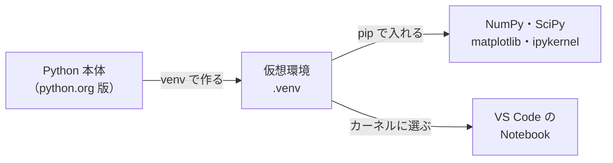

# 環境構築: Python と Notebook の準備

この教材では、各ステップの概念を手計算でつかんだあと、Python で計算を確かめたり、乱数で作った模擬データでシミュレーションしたりします。たとえば「平均をとるとばらつきが小さくなる」という性質も、サイコロを何千回も振る代わりに数行のコードで確かめられます。本書は、そのための作業環境を最初に一度だけ整える手順です。ここで作った環境は、以後のすべての演習 Notebook で使います。

| 項目 | 内容 |
|---|---|
| 想定する OS | Windows 10・11（作成時に Windows 11 で確認）。macOS・Linux での違いは [7節](#7-macoslinux-での違い未確認) に注記 |
| Python | 3.12 以上（作成時は 3.13 で確認）。理由は [2節](#2-python-本体を用意する) |
| エディタ | Visual Studio Code（VS Code） |
| 所要の目安 | 30分程度（ダウンロードの速さによる） |
| 必須か任意か | 必須（Python を使う演習の前提） |

> **期待する結果の出どころ**
> 各手順の後の「期待する結果」は、次の2種類があります。どちらかを見出しの後に書いています。
> - **確認済み**: 作成時に Windows 11 で実際に実行して得た表示です。
> - **想定**: パッケージの導入の表示や VS Code の画面など、環境や時期によって変わるため、仕様から想定した表示です。
>
> 手元で実行できない場合も、期待する結果と読み方を追えば、何が起きるかを理解できるようにしています。

## 0. 学習目標と完了条件

本書を終えると、次のことができるようになります。

1. 教材専用の仮想環境を作り、その中に必要なパッケージを入れられる。
2. 仮想環境の Python で、パッケージが入ったことと、その版を確かめられる。
3. VS Code で Notebook を開き、仮想環境をカーネルに選んで、セルを実行できる。

完了条件は、[5-4節](#5-4-確認のセルを実行する) の確認のセルを実行して、仮想環境の Python のパスとパッケージの版、そしてグラフが表示されることです。

## 1. 全体像

Python 本体には、標準の機能しか入っていません。数値計算の NumPy、統計の SciPy、グラフの matplotlib のような追加の部品（**パッケージ**）は、別に導入します。

このとき、パッケージを Python 本体へ直接入れると、他の作業で使っている Python にも影響します。そこで、教材のフォルダの中に **仮想環境（venv）** を作ります。仮想環境とは、Python 本体を元にして作る「その教材専用の Python の置き場所」のことで、ここに入れたパッケージは他の作業に影響しません。不要になれば、フォルダごと消せば元に戻ります。

Notebook（拡張子 `.ipynb`）は、説明の文・コード・実行結果のグラフを1つのファイルにまとめたものです。Notebook のコードを実際に動かす Python のことを **カーネル** と呼び、VS Code でこのカーネルに仮想環境の Python を選ぶと、演習のコードが教材専用の環境で動きます。カーネルとして選べるようにするための部品が `ipykernel` です。



## 2. Python 本体を用意する

[python.org のダウンロードのページ](https://www.python.org/downloads/) から、Windows 用のインストーラを入手して導入します。python.org 版には、版を指定して Python を呼び出す `py` コマンド（**Python ランチャー**）が付属します。

Python は **3.12 以上** を使います。作成時に導入された NumPy 2.5・SciPy 1.18 が、Python 3.12 以上を要求するためです（各パッケージの情報の `Requires-Python` で確認）。

導入したら、PowerShell で次を実行して、導入済みの Python の一覧を確かめます。

```powershell
py -0
```

**期待する結果**（確認済み）

```text
 -V:3.13 *        Python 3.13 (64-bit)
```

`-V:` の後の数字が、導入済みの Python の版です。3.12 以上の版が1つ以上あれば、次へ進めます。複数の版が並ぶこともあり、`*` は `py` を版の指定なしで呼んだときに使われる版を示します。

以後の手順では `py -3.13` と書きます。3.12 など別の版を使う場合は、その数字に読み替えてください。

## 3. 教材のフォルダを用意する

このリポジトリを手元に置きます。Git を使う場合は `git clone` で、使わない場合は GitHub のページの「Code」ボタンから ZIP をダウンロードして展開します。

```powershell
git clone <このリポジトリのURL>
```

```powershell
cd statistics-certification-study
```

以後のコマンドは、すべてこの教材のフォルダ（`README.md` がある場所）で実行します。

## 4. 仮想環境を作り、パッケージを入れる

### 4-1. 仮想環境を作る

```powershell
py -3.13 -m venv .venv
```

`-m venv` は Python 標準の仮想環境を作る機能を呼び出し、`.venv` は作るフォルダの名前です。

**期待する結果**（確認済み）

何も表示されずに終われば成功です。教材のフォルダに `.venv` フォルダができ、その中に仮想環境の Python（`.venv\Scripts\python.exe`）が置かれます。次のコマンドで確かめられます。

```powershell
Test-Path .venv\Scripts\python.exe
```

```text
True
```

`True` が表示されれば、仮想環境ができています。

> **仮想環境を「有効化」しない理由**
> 一般的な解説では、仮想環境を作った後に `.venv\Scripts\Activate.ps1` を実行して **有効化** し、以後は `python` とだけ打つ方法がよく紹介されます。ただし Windows の PowerShell では、スクリプトの実行を制限する設定（実行ポリシー）のために、有効化のスクリプトが動かないことがあり、動かすには設定を緩める必要があります。
> 本教材では設定を変えずに済むよう、有効化はせず、仮想環境の Python を `.venv\Scripts\python` とパスで直接呼びます。結果は有効化した場合と同じです。

### 4-2. pip を更新する

**pip** は、パッケージを導入する Python 標準の道具です。最初に pip 自身を最新にしておきます。

```powershell
.venv\Scripts\python -m pip install --upgrade pip
```

**期待する結果**（想定）

```text
Successfully installed pip-<版>
```

すでに最新の場合は、次のように表示されます（確認済み）。どちらでも成功です。

```text
Requirement already satisfied: pip in .\.venv\Lib\site-packages (26.2.1)
```

### 4-3. 必要なパッケージを入れる

```powershell
.venv\Scripts\python -m pip install numpy scipy matplotlib ipykernel
```

| パッケージ | 役割 |
|---|---|
| NumPy | 配列の計算、乱数の生成（模擬データづくり） |
| SciPy | 確率分布、検定、回帰などの統計の計算 |
| matplotlib | ヒストグラム・散布図などのグラフ |
| ipykernel | 仮想環境を Notebook のカーネルとして選べるようにする |

**期待する結果**（想定）

ダウンロードと導入の経過が数十行表示され、最後に次のような行が出れば成功です。依存して一緒に入るパッケージも並ぶため、行は長くなります。版の数字は導入した時期によって変わります。

```text
Successfully installed ... ipykernel-7.4.0 ... matplotlib-3.11.2 ... numpy-2.5.4 ... scipy-1.18.1 ...
```

`ERROR:` で始まる行が出た場合は、[6節](#6-うまくいかないとき) を見てください。

### 4-4. 導入できたかを確かめる

```powershell
.venv\Scripts\python -c "import numpy, scipy, matplotlib, ipykernel; print('numpy', numpy.__version__); print('scipy', scipy.__version__); print('matplotlib', matplotlib.__version__); print('ipykernel', ipykernel.__version__)"
```

`-c` は、続く文字列を Python のコードとして実行する指定です。4つのパッケージを読み込み、それぞれの版を表示します。

**期待する結果**（確認済み）

```text
numpy 2.5.4
scipy 1.18.1
matplotlib 3.11.2
ipykernel 7.4.0
```

4行すべてが表示されれば成功です。版の数字は、導入した時期によってこれより新しくなることがあります。`ModuleNotFoundError` が出た場合は、そのパッケージが入っていません（[6節](#6-うまくいかないとき)）。

`.venv` フォルダは、手元の環境ごとに作り直すものなので、Git では管理しません（`.gitignore` で除外しています）。

## 5. VS Code で Notebook を動かす

### 5-1. VS Code と拡張機能を入れる

[VS Code](https://code.visualstudio.com/) を導入し、左端の「拡張機能」（Extensions）の画面で、発行元が Microsoft の次の2つを入れます。

- **Python**
- **Jupyter**

名前が似た別の発行元の拡張機能もあるため、発行元の表示を確かめてください。

### 5-2. 教材のフォルダを開き、新しい Notebook を作る

1. VS Code のメニューの「ファイル」→「フォルダーを開く」で、教材のフォルダを開きます。
2. コマンドパレット（`Ctrl+Shift+P`）を開き、「Create: New Jupyter Notebook」を実行します。

保存していない新しい Notebook が開きます。動作の確認だけなので、保存は不要です。

### 5-3. カーネルに仮想環境を選ぶ

1. Notebook の右上の「カーネルの選択」（Select Kernel）を押します。
2. 「Python 環境」（Python Environments）を選びます。
3. 一覧から `.venv` と表示されたものを選びます。

**期待する結果**（想定）

右上の表示が `.venv (Python 3.13.16)` のような、仮想環境の名前と版に変わります。

### 5-4. 確認のセルを実行する

最初のセルに次のコードを入力し、`Shift+Enter` で実行します。前半は使っている Python の場所と版を表示し、後半は乱数で作った模擬データのヒストグラムを描きます。

```python
import sys

import matplotlib.pyplot as plt
import numpy as np
import scipy

# 使っている Python の場所と、パッケージの版を表示する
print(sys.executable)
print("numpy", np.__version__, "/ scipy", scipy.__version__)

# シードを固定した乱数で、平均 10.0・標準偏差 0.5 の模擬測定値を 1000 個作り、ヒストグラムを描く
rng = np.random.default_rng(seed=0)
values = rng.normal(loc=10.0, scale=0.5, size=1000)
plt.hist(values, bins=30)
plt.xlabel("measured value")
plt.ylabel("count")
plt.show()
```

**期待する結果**（コードの実行と描いたグラフは確認済み。VS Code の画面での見え方は想定）

```text
<教材のフォルダ>\.venv\Scripts\python.exe
numpy 2.5.4 / scipy 1.18.1
```

1行目が `.venv\Scripts\python.exe` で終わっていれば、仮想環境の Python で動いています。その下に、10.0 を中心にした山形のヒストグラムが表示されれば、環境構築は完了です。

実行したときに「ipykernel のインストールが必要」という案内が出た場合は、仮想環境ではない Python がカーネルに選ばれています。5-3節に戻って `.venv` を選び直してください。

## 6. うまくいかないとき

| 症状 | 考えられる原因 | 対処 |
|---|---|---|
| `py` が見つからない | Python ランチャーが入っていない | python.org 版のインストーラで Python を導入し直す。PowerShell を開き直してから再度試す |
| `py -0` に 3.12 以上が無い | 古い版しか入っていない | python.org から 3.12 以上を導入する |
| 4-3節で `ERROR:` が出て、版が合わない旨が表示される | Python の版が古い | 3.12 以上で仮想環境を作り直す（`.venv` フォルダを消してから 4-1節へ） |
| 4-4節で `ModuleNotFoundError` | 4-3節の導入が途中で止まった | 4-3節のコマンドをもう一度実行する |
| 5-3節の一覧に `.venv` が出ない | VS Code が教材のフォルダを開いていない、または仮想環境を作る前に開いた | 教材のフォルダを開き直す。それでも出ない場合は、一覧の「Python 環境の作成」ではなく、パスの指定で `.venv\Scripts\python.exe` を選ぶ |

## 7. macOS・Linux での違い（未確認）

作成時には確認していませんが、macOS・Linux では主に次の点が変わります。

| Windows（本書） | macOS・Linux |
|---|---|
| `py -3.13 -m venv .venv` | `python3 -m venv .venv`（`python3 --version` で 3.12 以上かを確かめる） |
| `.venv\Scripts\python` | `.venv/bin/python` |
| `Ctrl+Shift+P` | macOS では `Cmd+Shift+P` |

Linux では、ディストリビューションによって venv の機能が別のパッケージ（例: `python3-venv`）に分かれていることがあります。

## 作成時に確認した版

2026-10-17 に Windows 11 で確認しました。

| 道具 | 版 |
|---|---|
| Python | 3.13.16（python.org 版） |
| pip | 26.2.1 |
| NumPy | 2.5.4 |
| SciPy | 1.18.1 |
| matplotlib | 3.11.2 |
| ipykernel | 7.4.0 |

本教材では版を固定していません。より新しい版で動かない箇所があれば、上の版を指定して導入できます（例: `.venv\Scripts\python -m pip install numpy==2.5.4`）。

## 次に読むもの

[README](../README.md) の「読む順番」に戻り、次のステップへ進んでください。

## 出典

本書は、各ツールの公式サイトと、作成時の実際の動作の確認を元に、自分の言葉で書いたものです。他の文書の逐語の転載はありません。

- Python: <https://www.python.org/>
- Visual Studio Code: <https://code.visualstudio.com/>
