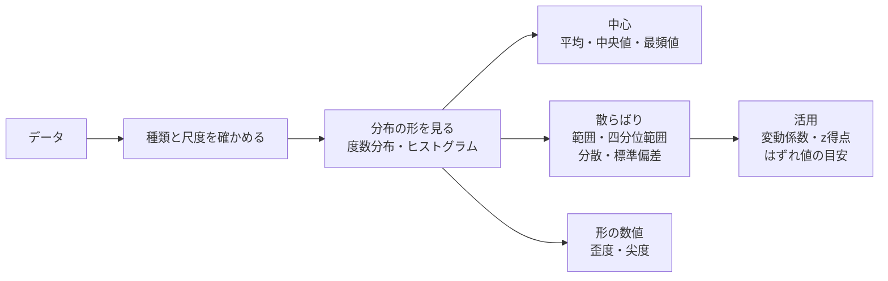

# ステップ1-1 記述統計: 1変数データ

新しく導入したセンサで、長さが分かっている部品を50回測ったとします。50個の数値が並んだ表を眺めても、「このセンサは信用できるのか」はすぐには分かりません。平均は基準の長さに近いのか。測るたびにどれくらいばらつくのか。1回だけ大きく外れた値は、センサの故障なのか、偶然なのか。こうした問いに答える第一歩は、たくさんの数値を、少数の「要約の数値」と「形が分かるグラフ」にまとめることです。これを **記述統計** と呼びます。

本書では、1種類の量（1変数）のデータを要約する道具を学びます。ここで学ぶ平均・標準偏差・箱ひげ図は、以後のすべてのステップで使います。ステップ6の推定やステップ7の検定は、本書で学ぶ要約の数値を出発点にして「真の値はどこにあるか」「差は偶然か」を判断する手続きです。

| 項目 | 内容 |
|---|---|
| 前提 | [学習ロードマップ](roadmap.md) を読んでいること。Notebook を動かす場合は [環境構築](setup.md) を終えていること |
| 演習 | [notebooks/step1-1_univariate.ipynb](../notebooks/step1-1_univariate.ipynb) |
| 所要の目安 | 本文 2〜3時間、演習 1時間 |
| 道具 | 電卓（四則・%・√）。Notebook は任意だが、9節の工学の例題は Notebook の結果を読む |

> **期待する結果の出どころ**
> 9節に載せた Notebook の表示は、作成時に Windows 11 の Python 3.13・NumPy 2.5.4 で実行して確かめた表示です。乱数のシードを固定しているので同じ表示になるはずですが、NumPy の版によっては模擬データの値がわずかに変わることがあります。
> 手元で実行できない場合も、本文の表示と読み方を追えば内容を理解できるようにしています。

## 0. 学習目標と完了条件

本書を終えると、次のことができるようになります。

1. データの種類（質的・量的）と尺度（名義・順序・間隔・比例）を見分けられる。
2. 度数分布表とヒストグラムを作り、分布の形（対称・右に裾が長い等）を言葉で説明できる。
3. 平均・中央値・最頻値を求め、分布の形との関係を説明できる。
4. 範囲・四分位範囲・分散・標準偏差・変動係数を電卓で求め、箱ひげ図とはずれ値の目安を説明できる。
5. z得点で、1つの値が分布の中のどこにあるかを表せる。
6. 歪度・尖度、ローレンツ曲線・ジニ係数が何を表すかを説明できる。
7. 2台のセンサの測定値を要約し、「偏り」と「ばらつき」を分けて評価できる。

完了条件は、10節の確認問題を解答を見ずに解き、解説と照らして考え方まで合っていることです。

## 1. 全体像

1変数のデータを要約するときは、まずデータの種類を確かめ、次に分布の形をグラフで見てから、中心と散らばりを数値にまとめます。



数値だけを先に計算すると、分布の形の特徴（外れた値、山が2つある等）を見落とします。グラフで形を見てから数値を選ぶ、という順番が大切です。

## 2. データの種類と尺度

データは、大きく2種類に分かれます。

- **質的変数**（カテゴリカル・データ）: 分類を表すもの。例: センサの型番、外観検査の判定（A・B・C）。
- **量的変数**: 数量を表すもの。さらに、個数のように飛び飛びの値をとる **離散型** と、長さのように連続した値をとる **連続型** に分かれる。

データの値がどのような意味を持つかによって、4つの **尺度** に分ける見方もあります。

| 尺度 | 意味 | 工学の例 | 意味のある計算 |
|---|---|---|---|
| 名義尺度 | 区別するだけ | センサの型番、製造ラインの名前 | 個数を数える、最頻値 |
| 順序尺度 | 順序に意味がある | 外観検査の判定（A＞B＞C） | 上に加えて中央値、順位 |
| 間隔尺度 | 差に意味があり、0は便宜上の点 | 温度（℃） | 上に加えて差、平均 |
| 比例尺度 | 0が「無い」を表し、比に意味がある | 長さ（mm）、質量、電圧 | 上に加えて比（2倍等） |

温度（℃）は間隔尺度です。20℃と10℃の差（10℃）には意味がありますが、「20℃は10℃の2倍熱い」とは言えません。0℃は水が凍る温度を便宜上0と決めた点で、熱が無いことを表すわけではないからです。一方、長さ 20 mm は 10 mm の2倍と言えるので比例尺度です。

**試験での問われ方**: 例を挙げて、どの尺度に当たるかを選ばせる形が典型です。迷ったら「0が無いことを表すか」「比に意味があるか」で間隔尺度と比例尺度を見分けます。

## 3. 度数分布とヒストグラム

### 3-1. 度数分布表

量的変数の値を、いくつかの区間（**階級**）に分け、各階級に入る個数（**度数**）を数えた表が **度数分布表** です。各階級を代表する値（ふつうは階級の真ん中の値）を **階級値** と呼びます。

部品の長さを10回測り、0.2 mm 幅の階級にまとめた例です。

| 階級（mm） | 階級値 | 度数 | 相対度数 | 累積度数 | 累積相対度数 |
|---|---|---|---|---|---|
| 9.7以上 9.9未満 | 9.8 | 2 | 0.2 | 2 | 0.2 |
| 9.9以上 10.1未満 | 10.0 | 5 | 0.5 | 7 | 0.7 |
| 10.1以上 10.3未満 | 10.2 | 3 | 0.3 | 10 | 1.0 |
| 合計 | | 10 | 1.0 | | |

- **相対度数**: 度数を全体の個数で割ったもの。個数の違うデータどうしを比べるときに使う。
- **累積度数**・**累積相対度数**: その階級までの度数・相対度数を足し上げたもの。「10.1 mm 未満が全体の70%」のように読む。

元の値が分からず度数分布表だけがあるときは、各階級の値をすべて階級値とみなして平均を求めます。

$$
\bar{x} = \frac{9.8 \times 2 + 10.0 \times 5 + 10.2 \times 3}{10} = \frac{19.6 + 50.0 + 30.6}{10} = 10.02
$$

### 3-2. ヒストグラムと分布の形

度数分布表を、横軸に階級、縦軸に度数をとった柱のグラフにしたものが **ヒストグラム** です。ヒストグラムからは、分布の形が読み取れます。

| 形 | 特徴 | 工学の例 |
|---|---|---|
| 左右対称の山形（ベル型） | 中心の近くに多く、両側に同じように減る | 同じ条件での繰り返し測定のばらつき |
| 右に裾が長い | 大きな値の側に長く伸びる | 作業にかかる時間、故障までの時間 |
| 左に裾が長い | 小さな値の側に長く伸びる | 上限が決まっている量（例: 100%に近い歩留まり） |
| 一様（平ら） | どの階級もほぼ同じ度数 | 丸めの誤差 |
| 山が2つ（二峰） | 山が2つある | 2台の装置や2ロットの製品が混ざったデータ |

山が2つあるヒストグラムは、性質の違う2つの集団が混ざっている合図です。工学のデータでは、まず「何が混ざっているか」を疑います。

この他に、値を「幹（上の桁）」と「葉（下の桁）」に分けて並べる **幹葉図**、累積相対度数を折れ線にした **累積相対度数グラフ** もあります。

## 4. 代表値: 平均・中央値・最頻値

分布の中心を1つの数値で表すものを **代表値** と呼びます。ここからは、部品の長さを6回測った次のデータ（単位 mm）を例に使います。

```text
10.1  9.9  10.0  10.2  9.8  10.6
```

### 4-1. 平均

すべての値を足して、個数で割ったものです。データを $x_1, x_2, \ldots, x_n$ とすると、平均 $\bar{x}$ は次の式で表します。 $\sum$ は「 $i=1$ から $n$ まで足す」ことを表す記号です。

$$
\bar{x} = \frac{1}{n}\sum_{i=1}^{n} x_i
$$

$$
\bar{x} = \frac{10.1 + 9.9 + 10.0 + 10.2 + 9.8 + 10.6}{6} = \frac{60.6}{6} = 10.1
$$

### 4-2. 中央値

値を小さい順に並べたときに、真ん中に来る値です。個数が偶数のときは、真ん中の2つの平均をとります。

```text
9.8  9.9  10.0  10.1  10.2  10.6
```

真ん中の2つは 10.0 と 10.1 なので、中央値は $(10.0 + 10.1) / 2 = 10.05$ です。

### 4-3. 最頻値

最も多く現れる値です。連続型のデータでは同じ値がほとんど重ならないので、度数分布表で度数が最も多い階級の階級値を使います。3-1節の表では 10.0 mm です。

### 4-4. 分布の形と代表値の関係

6個のデータでは、平均（10.1）が中央値（10.05）より大きくなりました。大きな値の 10.6 が1つあり、平均を引き上げたためです。中央値は真ん中の順位の値しか見ないので、端の値が大きくなっても変わりません。この性質を「外れた値に **頑健**（がんけん）である」と言います。

| 分布の形 | 代表値の大小の典型 |
|---|---|
| 左右対称 | 平均 ≒ 中央値 ≒ 最頻値 |
| 右に裾が長い | 最頻値 ＜ 中央値 ＜ 平均 |
| 左に裾が長い | 平均 ＜ 中央値 ＜ 最頻値 |

**試験での問われ方**: ヒストグラムや箱ひげ図を見せて、平均と中央値の大小を選ばせる形が典型です。「裾の長い側に平均が引っ張られる」と覚えます。

## 5. 散らばり（1）: 範囲・四分位範囲・箱ひげ図

### 5-1. 範囲

最大値から最小値を引いたものです。6個のデータでは $10.6 - 9.8 = 0.8$ です。計算は簡単ですが、端の2つの値だけで決まるので、外れた値1つで大きく変わります。

### 5-2. 四分位数と四分位範囲

小さい順に並べたデータを、個数が等しくなるように4つに分ける位置の値を **四分位数** と呼びます。小さい側から第1四分位数 $Q_1$、第2四分位数（中央値）、第3四分位数 $Q_3$ です。

本書では、次の求め方を使います。日本の中学校の数学で扱う求め方と同じです。

1. 中央値でデータを下半分と上半分に分ける（個数が奇数のときは、中央値そのものはどちらにも入れない）。
2. 下半分の中央値を $Q_1$、上半分の中央値を $Q_3$ とする。

6個のデータでは、下半分が 9.8・9.9・10.0 で $Q_1 = 9.9$、上半分が 10.1・10.2・10.6 で $Q_3 = 10.2$ です。 $Q_3 - Q_1$ を **四分位範囲** と呼び、ここでは $10.2 - 9.9 = 0.3$ です。四分位範囲は真ん中の半分のデータの幅なので、端の値の影響を受けにくい散らばりの指標です。

> **四分位数の求め方は1つではない**
> 四分位数には、順位の間を直線で補う方法など、いくつもの求め方があります。表計算ソフトや Python のライブラリは、それぞれ既定の求め方が違います。たとえば NumPy の `np.percentile` の既定の方法では、同じ6個のデータで $Q_1 = 9.925$、 $Q_3 = 10.175$ になります（Notebook の2-2節）。データの個数が多ければ差は小さくなります。手計算と道具の結果が少し合わないときは、まず求め方の違いを疑います。試験の問題を解くときは、問題文に示された求め方に従います。

### 5-3. 箱ひげ図とはずれ値の目安

**箱ひげ図** は、 $Q_1$ から $Q_3$ までを箱で、中央値を箱の中の線で表し、箱の外に「ひげ」を伸ばした図です。分布の中心・散らばり・偏りを一目で比べられるので、複数の装置や条件を並べて比べるときに便利です。

ひげの描き方にも流儀がありますが、よく使われるのは次の決め方です。

- 箱から四分位範囲の1.5倍までの範囲を **はずれ値の目安** の内側とし、ひげはその内側にある最も遠い値まで伸ばす。
- 目安の外にある値は、点で個別に描く。

6個のデータでは、目安の範囲は次のとおりです。

$$
Q_1 - 1.5 \times 0.3 = 9.45 \qquad Q_3 + 1.5 \times 0.3 = 10.65
$$

10.6 は大きく見えますが、目安の範囲の内側なので、箱ひげ図では点として描かれません。

**はずれ値の目安は「除いてよい」という判定ではありません。** 目安の外の値は「ほかと比べて離れているので、理由を調べる価値がある」という合図です。測定のミス（読み違い、ノイズ）なら除く理由になりますが、本当に起きた現象なら、それこそが重要な情報かもしれません。除くかどうかは、測定の記録や物理的な理由で判断します（ステップ9で詳しく扱います）。

## 6. 散らばり（2）: 分散・標準偏差・変動係数・z得点

### 6-1. 偏差

各値から平均を引いたもの $x_i - \bar{x}$ を **偏差** と呼びます。偏差は平均からのずれで、足し合わせると必ず0になります。そのため、散らばりの大きさを表すには、偏差を2乗してから足します。

### 6-2. 分散と標準偏差

偏差の2乗の和を $n-1$ で割ったものを **分散** $s^2$、その正の平方根を **標準偏差** $s$ と呼びます。

$$
s^2 = \frac{1}{n-1}\sum_{i=1}^{n} (x_i - \bar{x})^2 \qquad s = \sqrt{s^2}
$$

6個のデータ（平均 10.1）で計算します。

| $x_i$ | 偏差 $x_i - \bar{x}$ | 偏差の2乗 |
|---|---|---|
| 10.1 | 0.0 | 0.00 |
| 9.9 | −0.2 | 0.04 |
| 10.0 | −0.1 | 0.01 |
| 10.2 | 0.1 | 0.01 |
| 9.8 | −0.3 | 0.09 |
| 10.6 | 0.5 | 0.25 |
| 合計 | 0.0 | 0.40 |

$$
s^2 = \frac{0.40}{6 - 1} = 0.08 \qquad s = \sqrt{0.08} \approx 0.283
$$

電卓では、0.08 を入力して √ を押します。標準偏差は元のデータと同じ単位（mm）を持つので、「測定値はおおよそ ±0.28 mm 程度ばらつく」と読めます。

> **$n$ で割るか、 $n-1$ で割るか**
> 分散には、 $n$ で割る定義もあります。手元のデータそのものの散らばりを表すだけなら $n$ で割り、手元のデータから「測定を無限に繰り返したときのばらつき」を見積もるときは $n-1$ で割ります。 $n-1$ で割る理由は、ステップ6の推定（不偏性）で説明します。本教材は統計検定2級の範囲表に合わせて $n-1$ で割る定義を基本にします。試験の問題を解くときは、問題文の定義に従います。

### 6-3. 変動係数

標準偏差を平均で割ったものを **変動係数**（CV）と呼び、百分率で表すことがよくあります。

$$
\mathrm{CV} = \frac{s}{\bar{x}} = \frac{0.283}{10.1} \approx 0.028 = 2.8\%
$$

変動係数は単位を持たないので、大きさや単位の違う量のばらつきを比べるときに使います。たとえば、直径 5 mm の軸のばらつき 0.01 mm と、長さ 200 mm の板のばらつき 0.2 mm では、標準偏差は板のほうが大きくても、変動係数は軸が 0.2%、板が 0.1% で、軸のほうが相対的にばらついています。なお、変動係数は比例尺度のデータ（0に意味がある量）にだけ使います。温度（℃）のように0が便宜上の点だと、平均で割る意味がありません。

### 6-4. z得点と偏差値

1つの値が、平均から標準偏差の何個分離れているかを表すのが **z得点**（標準化した値）です。

$$
z = \frac{x - \bar{x}}{s}
$$

6個のデータの 10.6 は、 $z = (10.6 - 10.1) / 0.283 \approx 1.77$ で、平均より標準偏差の約1.8個分大きい値です。z得点にすると、単位や大きさの違うデータの中での位置を、同じ物差しで比べられます。z得点を、平均が50・標準偏差が10になるように換算したものが **偏差値**（ $50 + 10z$ ）です。

## 7. 分布の形の数値: 歪度・尖度

ヒストグラムの形を、数値で表す指標もあります。

**歪度**（わいど）は、分布の左右の非対称さを表します。

$$
\text{歪度} = \frac{1}{n}\sum_{i=1}^{n}\left(\frac{x_i - \bar{x}}{\sigma}\right)^3
$$

ここで $\sigma$ は、 $n$ で割った分散の平方根です。偏差を3乗するので、大きな偏差の符号が強く効きます。

- 右に裾が長い → 歪度は正
- 左右対称 → 歪度はほぼ0
- 左に裾が長い → 歪度は負

6個のデータでは、 $n$ で割った分散が $0.40 / 6 \approx 0.0667$、偏差の3乗の和が $0 - 0.008 - 0.001 + 0.001 - 0.027 + 0.125 = 0.090$ なので、次のようになります。

$$
\text{歪度} = \frac{0.090 / 6}{0.0667 \times \sqrt{0.0667}} \approx \frac{0.0150}{0.0172} \approx 0.87
$$

10.6 の大きな値のために、右に裾が長い（正の）値になりました。

**尖度**（せんど）は、分布の裾の重さ（外れた値の出やすさ）と、山のとがり方を表します。偏差を標準化して4乗した平均で、正規分布（ステップ4で学ぶ、左右対称のベル型の分布）では3になります。そこで、3を引いて正規分布を0とする定義もよく使われます。Notebook の3節では、3を引いた定義で、次の値になりました（各1000個の模擬データ）。

| 形 | 歪度 | 尖度（3を引いた値） |
|---|---|---|
| 左右対称の山形（正規分布） | −0.01 | 0.12 |
| 右に裾が長い（対数正規分布） | 1.56 | 2.99 |
| 平ら（一様分布） | −0.06 | −1.21 |

歪度・尖度には、ここで示した以外の定義（ $n-1$ を使う補正をしたもの等）もあります。道具によって値が少し違うことがあるので、使った定義を書き添えます。

## 8. 偏りの数値: ローレンツ曲線とジニ係数

全体の量が、一部に集中しているかどうかを表す道具です。もとは所得の格差を表すために考えられたものですが、工学では、不具合が一部の装置に集中しているか、といった場面に応用できます。

4台の装置で、1か月の不具合の件数が 1・1・2・6 件（合計10件）だったとします。件数の少ない装置から順に並べ、装置の台数の累積の割合を横軸に、件数の累積の割合を縦軸にとって点を結んだものが **ローレンツ曲線** です。

| 装置（少ない順） | 件数 | 台数の累積の割合 | 件数の累積の割合 |
|---|---|---|---|
| — | — | 0 | 0 |
| 1台目 | 1 | 0.25 | 0.1 |
| 2台目 | 1 | 0.50 | 0.2 |
| 3台目 | 2 | 0.75 | 0.4 |
| 4台目 | 6 | 1.00 | 1.0 |

すべての装置の件数が等しければ、曲線は対角線（完全平等線）に重なります。集中が強いほど、曲線は右下にたわみます。

**ジニ係数** は、対角線とローレンツ曲線に囲まれた面積の2倍で、0（完全に平等）から1（1つに集中）の値をとります。ローレンツ曲線の下の面積を台形の和で求めると、次のようになります。

$$
\text{面積} = 0.25 \times \frac{(0 + 0.1) + (0.1 + 0.2) + (0.2 + 0.4) + (0.4 + 1.0)}{2} = 0.25 \times \frac{2.4}{2} = 0.3
$$

$$
\text{ジニ係数} = 1 - 2 \times 0.3 = 0.4
$$

対角線の下の面積は0.5なので、「対角線と曲線の間の面積 × 2」は $(0.5 - 0.3) \times 2 = 0.4$ で、同じ値になります。Notebook の2-5節に、この曲線の図があります。

## 9. 工学の例題: 2台のセンサのばらつきを比べる

長さが 10.000 mm と分かっている基準のブロックを、2台のセンサ A・B でそれぞれ50回ずつ測りました。どちらのセンサが、どういう点で優れているかを、要約統計量とグラフから判断します。データは乱数で作った模擬データで、作り方の条件は Notebook の4節にあります。

### 9-1. 要約統計量を並べる

Notebook の4-1節で、2台の要約統計量を求めます。

**期待する結果**（Notebook の4-1節の表示）:

```text
A  平均 10.0027  中央値 10.0015  標準偏差 0.0197  四分位範囲 0.0223  最小 9.9542  最大 10.0415  歪度 -0.15
B  平均 10.0377  中央値 10.0329  標準偏差 0.0312  四分位範囲 0.0147  最小 10.0118  最大 10.1864  歪度 4.10
```

読み方は次のとおりです。

- **中心**: A は平均・中央値とも基準の 10.000 mm に近い。B は中央値でも約 0.033 mm 大きく、基準からずれている。
- **散らばり**: 標準偏差は B（0.031）のほうが大きいのに、四分位範囲は B（0.015）のほうが小さい。2つの指標の大小が逆になっている。
- **形**: B の歪度は 4.10 と大きな正の値で、右に長い裾がある。最大値 10.1864 も、他の値から離れている。

散らばりの指標どうしで結論が食い違うのは、外れた値が混ざっている合図です。標準偏差は偏差を2乗するので、外れた値に強く引っ張られます。四分位範囲は真ん中の半分しか見ないので、影響を受けません。

### 9-2. グラフで形を確かめる

Notebook の4-2節で、ヒストグラムと箱ひげ図を並べます。

**期待する結果**（Notebook の4-2節のグラフ）: 左のヒストグラムでは、A の山が基準の破線のまわりに広がり、B の山はそれより右で細くとがっています。B には 10.18 mm 付近に、山から離れた小さな柱があります。右の箱ひげ図では、B の箱が A より短く、基準の破線より上にあります。B の上には2つの白丸（はずれ値の目安の外の点）があり、A の下にも1つの白丸があります。

A の白丸は、正規分布に従う模擬データから偶然生まれた点です。正規分布に従うデータでも、1000個に7個ほどは目安の外に出ます。目安の外の点が1つあることだけでは、異常とは言えません。一方、B の2点は山から大きく離れていて、ヒストグラムでも別の集まりに見えます。

### 9-3. 外れた2点の影響を確かめる

Notebook の4-3節で、B のはずれ値の目安の外にある点を取り出し、それらを除いた場合と比べます。

**期待する結果**（Notebook の4-3節の表示、一部）:

```text
はずれ値の目安の範囲 10.0030 〜 10.0616
範囲の外の点        [10.1864 10.1793]
B（全点）      平均 10.0377  中央値 10.0329  標準偏差 0.0312  四分位範囲 0.0147  ...
B（目安の外を除く）  平均 10.0316  中央値 10.0324  標準偏差 0.0089  四分位範囲 0.0143  ...
```

2点を除くと、標準偏差は 0.031 から 0.009 へと3分の1以下になりますが、中央値と四分位範囲はほとんど変わりません。

### 9-4. 判断をまとめる

ここまでの数値とグラフから、次のように整理できます。

| 観点 | センサ A | センサ B |
|---|---|---|
| 偏り（中心と基準のずれ） | ほぼ無い | 約 +0.03 mm |
| ばらつき（外れた点を除く） | 標準偏差 約 0.020 mm | 標準偏差 約 0.009 mm |
| 外れた値 | 目立つものは無い | 50回中2回、+0.15 mm 前後 |

センサの性能を表すとき、測定値の平均が真の値にどれだけ近いかを **真度**、測定値どうしがどれだけそろっているかを **精度**（精密さ）と呼んで区別します。A は真度が高く、B は精度が高いセンサです。

B の偏りは、毎回ほぼ同じだけずれる性質なので、基準のブロックで校正（ずれの量を測って差し引く）すれば補正できます。ばらつきは校正では減らせないので、B は校正すれば A より良いセンサになる可能性があります。ただし、2回の大きな外れた値の原因（電気的なノイズ、取り付けのゆるみ等）は、除いて終わりにせず、調べる必要があります。原因が分からないまま使うと、実際の測定でも同じ外れ方が起きます。

このように、1つの指標だけでセンサの良し悪しを決めず、中心・散らばり・形を分けて見ることが、データの妥当性を判断する第一歩です。

## 10. 確認問題

### 問1（選択）

次のうち、間隔尺度のデータはどれか。

1. 部品に付けた通し番号
2. 外観検査の判定（A・B・C）
3. 室温（℃）
4. 部品の質量（g）

<details>
<summary>解答と解説</summary>

**3**。室温（℃）は差に意味がありますが、0℃は便宜上の点なので比に意味がなく、間隔尺度です。1は区別のためだけの名義尺度、2は順序に意味がある順序尺度、4は0が「質量が無い」を表し比に意味がある比例尺度です（2節）。

</details>

### 問2（計算）

ある抵抗器の抵抗値を5回測り、次の値（単位 kΩ）を得た。平均・中央値・分散（ $n-1$ で割る）・標準偏差・変動係数を求めよ。

```text
20.4  19.8  20.0  20.6  19.2
```

<details>
<summary>解答と解説</summary>

- 平均: $(20.4 + 19.8 + 20.0 + 20.6 + 19.2) / 5 = 100.0 / 5 = 20.0$ kΩ
- 中央値: 小さい順に 19.2・19.8・20.0・20.4・20.6 と並べて、真ん中の 20.0 kΩ
- 偏差: 0.4・−0.2・0.0・0.6・−0.8。偏差の2乗: 0.16・0.04・0.00・0.36・0.64。和は 1.20
- 分散: $1.20 / (5 - 1) = 0.30$ kΩ²
- 標準偏差: $\sqrt{0.30} \approx 0.548$ kΩ
- 変動係数: $0.548 / 20.0 \approx 0.027 = 2.7\%$

分散の単位が元の単位の2乗（kΩ²）になることにも注意します（6-2節）。

</details>

### 問3（計算）

8個の測定値（単位 mm）について、中央値・ $Q_1$ ・ $Q_3$ ・四分位範囲を5-2節の方法で求め、はずれ値の目安の外にある値があるか答えよ。

```text
3.1  3.4  3.5  3.6  3.8  3.9  4.0  5.2
```

<details>
<summary>解答と解説</summary>

- 中央値: 4番目と5番目の平均で $(3.6 + 3.8) / 2 = 3.7$
- 下半分 3.1・3.4・3.5・3.6 の中央値: $Q_1 = (3.4 + 3.5) / 2 = 3.45$
- 上半分 3.8・3.9・4.0・5.2 の中央値: $Q_3 = (3.9 + 4.0) / 2 = 3.95$
- 四分位範囲: $3.95 - 3.45 = 0.5$
- はずれ値の目安: 下は $3.45 - 0.75 = 2.70$、上は $3.95 + 0.75 = 4.70$

5.2 は 4.70 より大きいので、目安の外にあります。ただし、これは「理由を調べる価値がある」という合図で、除いてよいという判定ではありません（5-3節）。

</details>

### 問4（選択）

ある工程で、製品1個の加工にかかった時間を記録した。ヒストグラムは、短い時間に山があり、長い時間の側に裾が長く伸びていた。このデータについて、正しい組み合わせはどれか。

1. 平均 ＜ 中央値、歪度は負
2. 平均 ＜ 中央値、歪度は正
3. 平均 ＞ 中央値、歪度は負
4. 平均 ＞ 中央値、歪度は正

<details>
<summary>解答と解説</summary>

**4**。右（大きな値の側）に裾が長い分布では、平均が裾の側に引っ張られて中央値より大きくなり、歪度は正になります（4-4節・7節）。

</details>

### 問5（計算）

ある材料の引張強さは、多数の試験片の測定で平均 420 MPa、標準偏差 15 MPa だった。新しい試験片の引張強さが 450 MPa だったとき、z得点と偏差値を求めよ。

<details>
<summary>解答と解説</summary>

- z得点: $(450 - 420) / 15 = 2.0$
- 偏差値: $50 + 10 \times 2.0 = 70$

平均より標準偏差の2個分大きい値です（6-4節）。

</details>

### 問6（選択）

直径の平均が 5.00 mm・標準偏差が 0.01 mm の軸と、長さの平均が 200.0 mm・標準偏差が 0.2 mm の板がある。相対的なばらつきについて、正しいものはどれか。

1. 標準偏差が大きいので、板のほうが相対的にばらついている
2. 変動係数は軸が 0.2%、板が 0.1% で、軸のほうが相対的にばらついている
3. 単位が同じ mm なので、標準偏差で比べれば十分である
4. 平均が違うので、相対的なばらつきは比べられない

<details>
<summary>解答と解説</summary>

**2**。変動係数は軸が $0.01 / 5.00 = 0.002 = 0.2\%$、板が $0.2 / 200.0 = 0.001 = 0.1\%$ です。大きさの違う量のばらつきは、標準偏差ではなく変動係数で比べます（6-3節）。

</details>

### 問7（記述）

2台の温度計 P・Q で、0.0℃に保った氷水を20回ずつ測り、次の要約を得た。実験の現場で「どちらの温度計を使うべきか」と聞かれたとき、どう答えるか。判断の根拠と、使う前に確かめるべきことを書け。

| 温度計 | 平均 | 中央値 | 標準偏差 | 四分位範囲 |
|---|---|---|---|---|
| P | 0.02℃ | 0.02℃ | 0.15℃ | 0.20℃ |
| Q | 0.31℃ | 0.30℃ | 0.04℃ | 0.05℃ |

<details>
<summary>解答と解説</summary>

解答の例:

- P は平均・中央値が 0.0℃に近く偏りは小さいが、標準偏差が 0.15℃で、測るたびのばらつきが大きい（真度は高いが、精度は低い）。
- Q は約 +0.3℃の偏りがあるが、標準偏差は 0.04℃で、ばらつきは P の4分の1ほどと小さい（精度は高いが、真度は低い）。
- 平均と中央値、標準偏差と四分位範囲の関係にどちらも大きな食い違いが無いので、外れた値が結果を大きく動かしている様子は無い。
- 偏りは校正で補正できるが、ばらつきは補正できない。したがって、Q を 0℃以外の基準温度（例: 別の定点）でも測って偏りが一定かを確かめ、校正して使うのがよい。校正できない状況ですぐに使うなら、1回の測定のばらつきが許容できるかで P を選ぶ判断もありうる。

要点は、「偏り」と「ばらつき」を分けて評価し、偏りは校正で直せることを踏まえて判断することです（9-4節）。

</details>

## 次に読むもの

[README](../README.md) の「読む順番」に戻り、次の冊（ステップ1-2 2変数データ）へ進んでください。

## 出典

本書は、統計検定2級・3級の出題範囲表（統計検定の公式サイトで公開）の項目を参考に、扱う内容を選んで自分の言葉で書いたものです。他の文書の逐語の転載はありません。例題と確認問題はすべて自作で、例題のデータは乱数で作った模擬データです。
