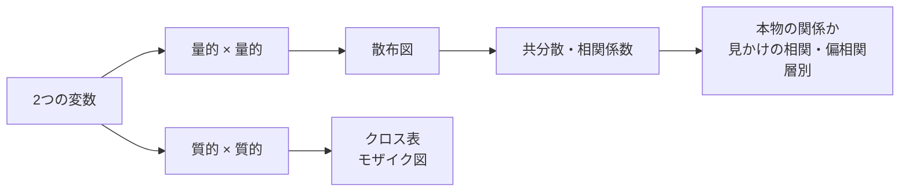

# ステップ1-2 記述統計: 2変数データ

センサの出力が、日によって少しずつ違うことに気づいたとします。記録を見返すと、湿度の高い日ほど出力が小さいように見えます。それなら湿度対策をすべきでしょうか。ところが、湿度の高い日は気温の低い日でもあります。出力を動かしているのは湿度なのか、温度なのか。2つ以上の量の関係を調べる道具が無いと、見当違いの対策に時間とお金を使うことになります。

本書では、2つの変数の関係を要約する道具を学びます。散布図と相関係数で関係の強さを測り、見かけの相関や層別の考え方で「その関係は本物か」を確かめます。ここで学ぶ相関の考え方は、ステップ2の回帰分析（一方の量からもう一方を予測する方法）の土台になります。

| 項目 | 内容 |
|---|---|
| 前提 | [ステップ1-1 記述統計: 1変数データ](step1-1_univariate.md)（平均・標準偏差・z得点を使う） |
| 演習 | [notebooks/step1-2_bivariate.ipynb](../notebooks/step1-2_bivariate.ipynb) |
| 所要の目安 | 本文 2時間、演習 1時間 |
| 道具 | 電卓（四則・%・√）。Notebook は任意だが、9節の工学の例題は Notebook の結果を読む |

> **期待する結果の出どころ**
> - 本文に載せた Notebook の数値（3節・4-3節・8-1節の文中の値と、5節・9節の期待する結果）: 作成時に Windows 11 の Python 3.13・NumPy 2.5.4 で実行して確かめた表示です。乱数のシードを固定しているので同じ表示になるはずですが、NumPy の版によっては模擬データの値がわずかに変わることがあります。
> - 5節・8-2節・9節のグラフの説明: 作成時に matplotlib 3.11.2 で描いた図を見て確かめたものです。
>
> 手元で実行できない場合も、本文の表示と読み方を追えば内容を理解できるようにしています。

## 0. 学習目標と完了条件

本書を終えると、次のことができるようになります。

1. 散布図を描き、2つの量の関係の向きと強さを読み取れる。
2. 共分散と相関係数を電卓で求め、相関係数の性質（−1〜1、単位によらない）を説明できる。
3. 相関係数だけでは分からないこと（曲線の関係、外れ値の影響）を、散布図と合わせて判断できる。
4. 相関と因果の違いを説明し、見かけの相関を偏相関係数と層別で見抜ける。
5. 3つ以上の変数の相関係数を相関行列にまとめて読める。
6. 質的変数どうしの関係を、クロス表の割合とモザイク図で比べられる。

完了条件は、10節の確認問題を解答を見ずに解き、解説と照らして考え方まで合っていることです。

## 1. 全体像

2つの変数の関係を調べるときは、量的変数どうしなら散布図、質的変数どうしならクロス表から始めます。数値（相関係数）は、図で関係の形を見てから使います。



## 2. 散布図

2つの量的変数を、1組ずつ横軸と縦軸にとって点を打った図が **散布図**（相関図）です。1組のデータが1つの点になります。

散布図からは、次のことが読み取れます。

| 見えるもの | 読み方 |
|---|---|
| 右上がり | 一方が大きいと、もう一方も大きい傾向（**正の相関**） |
| 右下がり | 一方が大きいと、もう一方は小さい傾向（**負の相関**） |
| 点の帯の細さ | 細い帯ほど関係が強い。丸く散らばっていれば関係は弱い |
| 帯の形 | 直線的か、曲がっているか |
| 離れた点 | ほかの点の集まりから外れた点（外れ値） |
| かたまり | 点が2つ以上のかたまりに分かれていれば、性質の違う集団が混ざっている可能性 |

工学では、温度と出力、荷重と変位のように、「原因になりそうな量」を横軸に、「結果として見たい量」を縦軸にとるのが一般的です。

なお、2つの量を1つの図に重ねる方法には、ほかに **複合グラフ**（例: 月ごとの生産量を棒グラフ、不良率を折れ線グラフにし、左右に別々の目盛りを付けたもの）もあります。こちらは時間の流れに沿って2つの量の動きを比べるのに向いています。

**試験での問われ方**: いくつかの散布図を見せて、関係の向きと強さを読み取らせる形が典型です。

## 3. 共分散

2つの変数の関係を数値で表す出発点が **共分散** です。 $n$ 組のデータ $(x_1, y_1), \ldots, (x_n, y_n)$ について、 $x$ の偏差と $y$ の偏差を掛けて足し、 $n-1$ で割ります。

$$
s_{xy} = \frac{1}{n-1}\sum_{i=1}^{n}(x_i - \bar{x})(y_i - \bar{y})
$$

偏差の積の符号を考えると、共分散の意味が分かります。散布図に、 $x$ の平均の位置で縦の線、 $y$ の平均の位置で横の線を引くと、図は4つの区画に分かれます。

| 区画 | $x - \bar{x}$ | $y - \bar{y}$ | 偏差の積 |
|---|---|---|---|
| 右上 | ＋ | ＋ | ＋ |
| 左下 | − | − | ＋ |
| 左上 | − | ＋ | − |
| 右下 | ＋ | − | − |

右上がりの散布図では、点が右上と左下の区画に多く集まり、しかも平均から遠い点ほど積が大きくなります。そのため正の積の合計が負の積の合計を上回り、共分散は正になります。共分散の符号を決めるのは、点の数ではなく積の大きさの合計です。

温度（℃）とセンサ出力（mV）を5回測った例で計算します。

| 温度 $x$ | 出力 $y$ | $x - \bar{x}$ | $y - \bar{y}$ | 偏差の積 | $(x - \bar{x})^2$ | $(y - \bar{y})^2$ |
|---|---|---|---|---|---|---|
| 10 | 101 | −20 | −4 | 80 | 400 | 16 |
| 20 | 104 | −10 | −1 | 10 | 100 | 1 |
| 30 | 104 | 0 | −1 | 0 | 0 | 1 |
| 40 | 108 | 10 | 3 | 30 | 100 | 9 |
| 50 | 108 | 20 | 3 | 60 | 400 | 9 |
| 合計 | | 0 | 0 | 180 | 1000 | 36 |

平均は $\bar{x} = 150 / 5 = 30$ 、 $\bar{y} = 525 / 5 = 105$ です。

$$
s_{xy} = \frac{180}{5 - 1} = 45
$$

試験では、偏差の表の代わりに $\sum x_i$ ・ $\sum y_i$ ・ $\sum x_i y_i$ などの合計だけが与えられることがあります。その場合は、偏差の積の和を次の式で求めます。

$$
\sum (x_i - \bar{x})(y_i - \bar{y}) = \sum x_i y_i - n\,\bar{x}\,\bar{y}
$$

5組の例では $\sum x_i y_i = 10 \times 101 + 20 \times 104 + 30 \times 104 + 40 \times 108 + 50 \times 108 = 15930$ なので、 $15930 - 5 \times 30 \times 105 = 15930 - 15750 = 180$ で、表の合計と一致します。同じように、 $\sum (x_i - \bar{x})^2 = \sum x_i^2 - n\bar{x}^2$ です。

> **共分散の分母: $n$ で割るか、 $n-1$ で割るか**
> 分散と同じく（ステップ1-1の6-2節）、共分散にも $n$ で割る定義があり、試験ではそちらが使われることもあります。問題文の定義を必ず確かめます。相関係数は、分子の共分散と分母の標準偏差で同じ定義（どちらも $n$ 、またはどちらも $n-1$ ）を使えば、どちらで計算しても同じ値になります。

共分散の単位は「℃ × mV」です。温度を華氏に、出力を V に換算すると、同じデータでも共分散は $45 \times 1.8 \times 0.001 = 0.081$ に変わります（Notebook の2-2節）。共分散の大きさは単位に左右されるので、関係の強さを比べる物差しには使えません。

**試験での問われ方**: 合計（ $\sum x_i y_i$ 等）から共分散を求めさせる計算や、散布図の4つの区画と共分散の符号の関係を問う形が典型です。

## 4. 相関係数

### 4-1. 定義

共分散を、 $x$ と $y$ の標準偏差の積で割ったものが **相関係数** $r$ です。

$$
r = \frac{s_{xy}}{s_x s_y} = \frac{\sum (x_i - \bar{x})(y_i - \bar{y})}{\sqrt{\sum (x_i - \bar{x})^2}\sqrt{\sum (y_i - \bar{y})^2}}
$$

右の形は、分子と分母の $n-1$ が打ち消し合うことを使って書き直したもので、手計算ではこちらが楽です。

相関係数は、ステップ1-1の6-4節で学んだz得点を使っても表せます。 $x$ と $y$ をそれぞれz得点に直し、組ごとに掛けて足し、 $n-1$ で割ったものが相関係数です。単位の無いz得点どうしの積なので、相関係数にも単位がありません。

### 4-2. 手計算

3節の表の合計を使います。

$$
r = \frac{180}{\sqrt{1000} \times \sqrt{36}} = \frac{180}{\sqrt{36000}} \approx \frac{180}{189.74} \approx 0.949
$$

電卓では、36000 を入力して √ を押し、180 をその値で割ります。標準偏差から求めても、 $s_x = \sqrt{1000/4} \approx 15.81$ 、 $s_y = \sqrt{36/4} = 3$ なので、 $r = 45 / (15.81 \times 3) \approx 0.949$ で同じ値になります。

### 4-3. 相関係数の性質

- **−1 から 1 の値をとる**。すべての点が右上がりの1本の直線に乗るときに1、右下がりの直線に乗るときに−1になる。
- **単位によらない**。どちらの変数を正の倍率で換算しても、平行に動かしても、相関係数は変わらない。片方を負の倍率で換算すると、符号だけが反転する。Notebook の2-2節で、温度を華氏、出力を V に換算しても $r = 0.9487$ のまま変わらないことを確かめられる。
- **直線的な関係の強さだけを表す**（5節で詳しく見る）。

相関係数の大きさの読み方の目安として、絶対値が 0.7 以上なら強い相関、0.4 以上 0.7 未満なら中程度、0.2 以上 0.4 未満なら弱い相関、0.2 未満ならほとんど相関が無い、と言うことがあります。ただし、これは慣習的な目安で、決まった基準ではありません。データの個数が少ないと、関係が無くても偶然に大きな値が出ることがあります（5節の (d)）。

**試験での問われ方**: 散布図をいくつか見せて相関係数の値と組み合わせさせる形や、単位を換算したときに共分散・相関係数がどう変わるかを問う形が典型です。

## 5. 相関係数だけでは分からないこと

相関係数は1つの数値なので、関係の形まで表すことはできません。Notebook の3節で、30組ずつの4つの模擬データの散布図と相関係数を並べます。

**期待する結果**（Notebook の3節の表示）:

```text
(a) linear           r = 0.876
(b) one far point    r = 0.743
(c) U-shaped         r = -0.069
(d) no relation      r = -0.202
(b) から外れた1点を除いた r = -0.165
```

散布図と合わせると、次のことが分かります。

- **(a) 直線的な関係**: 点が右上がりの帯になり、相関係数は 0.88 と大きい。相関係数が素直に当てはまる場合。
- **(b) 1点だけ大きく外れた点**: 29点は左下に丸く固まって関係が無いのに、右上に1点あるだけで相関係数は 0.74 になる。その1点を除くと −0.17 で、関係はほぼ無い。相関係数は外れ値に強く引っ張られる。ここで1点を除いた値は、その点の影響の大きさを見るための比較である。実際のデータで除くかどうかは、ステップ1-1の5-3節のとおり、測定の記録や物理的な理由で判断する。
- **(c) U字形の関係**: 横軸の値が決まれば縦軸の値がほぼ決まる、強い関係がある。しかし直線的な関係ではないので、相関係数は −0.07 とほぼ0になる。 **相関係数が0に近いことは、関係が無いことを意味しない**。
- **(d) 関係が無いデータ**: 点が丸く散らばっているが、相関係数は −0.20 で、ちょうど0にはならない。データが30組程度だと、関係が無くてもこのくらいの値は偶然に出る。偶然かどうかを判断する方法は、ステップ7の仮説検定で扱う。

**相関係数を使う前に、必ず散布図を見ます。**

**試験での問われ方**: 「相関係数が0に近ければ関係は無い」「外れ値があっても相関係数は変わらない」のような文の正誤を問う形が典型です。

## 6. 相関と因果: 見かけの相関と偏相関係数

### 6-1. 相関は因果を意味しない

2つの量 $x$ ・ $y$ に相関があるとき、その理由には次のようなものがあります。

- $x$ が $y$ の原因である
- 逆に、 $y$ が $x$ の原因である（逆の向きの因果）
- 第3の量が、 $x$ と $y$ の両方に影響している
- たまたま（データが少ないと、関係が無くても偶然に相関が出る。5節の (d)）

相関があるというだけでは、このどれなのかは分かりません。工学のデータでよく問題になるのは、3つ目の **第3の量が両方に影響している** 場合です。

工場で、月ごとの空調の消費電力と、接着剤の硬化不良の件数に、強い正の相関があったとします。空調を止めれば不良が減るでしょうか。そうではなく、夏は気温が高いので空調の電力が増え、同時に気温の高さが接着剤の硬化に影響して不良が増えている、と考えるほうが自然です。このように、第3の量（ここでは気温）を通して生まれる、因果関係の無い2つの量の相関を **見かけの相関**（擬相関、疑似相関とも呼ぶ）と呼びます。

因果関係を確かめる確実な方法は、原因と思われる量を自分で変えて結果を見る **実験** です。実験の計画の立て方は、ステップ3（データの集め方）とステップ8（実験計画）で扱います。

### 6-2. 偏相関係数

実験ができないときに、第3の量 $z$ の影響を取り除いた $x$ と $y$ の相関を数値で表すのが **偏相関係数** です。3つの相関係数 $r_{xy}$ 、 $r_{xz}$ 、 $r_{yz}$ から、次の式で求めます。

$$
r_{xy \cdot z} = \frac{r_{xy} - r_{xz}\,r_{yz}}{\sqrt{(1 - r_{xz}^2)(1 - r_{yz}^2)}}
$$

記号 $r_{xy \cdot z}$ は「 $z$ の影響を除いた、 $x$ と $y$ の偏相関係数」と読みます。点の後ろに、影響を除く変数を書きます。分子の $r_{xz}\,r_{yz}$ は、「 $z$ を通して $x$ と $y$ に生まれる相関」の分を表していて、それを $r_{xy}$ から差し引いています。

偏相関係数が取り除けるのは、 $z$ の **直線的な** 影響（ $z$ が1増えると $x$ や $y$ がほぼ一定の量だけ変わる、という形の影響）だけです。 $z$ の影響が曲線的なら、その分は取り除けずに残ります。

空調の消費電力 $x$ 、硬化不良の件数 $y$ 、気温 $z$ の相関係数が、 $r_{xy} = 0.6$ 、 $r_{xz} = 0.8$ 、 $r_{yz} = 0.75$ だったとします。

$$
r_{xy \cdot z} = \frac{0.6 - 0.8 \times 0.75}{\sqrt{(1 - 0.64)(1 - 0.5625)}} = \frac{0.6 - 0.6}{\sqrt{0.36 \times 0.4375}} = 0
$$

気温の影響を除くと、消費電力と不良の件数の相関は0になりました（Notebook の2-3節）。消費電力と不良の件数の相関（0.6）は、すべて気温を通した見かけの相関だったと考えられます。

偏相関係数は、影響を除きたい第3の量を測っていなければ使えません。どの量が第3の量になりうるかを考えるには、工学の知識（物理的な仕組み）が欠かせません。

**試験での問われ方**: 3つの相関係数を与えて偏相関係数を計算させる形と、見かけの相関の例から第3の量を選ばせる形が典型です。

## 7. 層別と相関行列

### 7-1. 層別

データを、装置・ロット・作業者・季節などの区分ごとに分けて見ることを **層別** と呼びます。性質の違う集団が混ざったデータでは、全体で見た関係と、区分ごとに見た関係が食い違うことがあります。9-3節では、全体では負の相関なのに、区分ごとに見るとどちらも正の相関、という例を扱います。このように、全体と区分ごとで関係の向きが逆になる現象は、 **シンプソンのパラドックス** という名前で知られています。

層別した散布図は、区分ごとに点の色や形を変えて描きます。散布図にかたまりが見えたら、何で区分できるかを考えます。

### 7-2. 相関行列

3つ以上の変数があるとき、すべての組み合わせの相関係数を表の形に並べたものが **相関行列** です。行と列に同じ変数を同じ順に並べ、交わるところにその2つの相関係数を書きます。対角線（同じ変数どうし）は1で、対角線をはさんで対称になります。9-1節に、実際の相関行列があります。

**試験での問われ方**: 相関行列から特定の2つの変数の相関係数を読み取らせる形や、層別した散布図を見せて、全体と区分ごとの関係の違いを読み取らせる形が典型です。

## 8. 質的変数どうしの関係: クロス表とモザイク図

### 8-1. クロス表

2つの質的変数の組み合わせごとに度数を数えた表が **クロス表**（2元の度数分布表、分割表）です。2つの製造ラインで作った製品の、外観検査の判定の例です。

| | 良 | 不良 | 合計 |
|---|---|---|---|
| ライン1 | 180 | 20 | 200 |
| ライン2 | 255 | 45 | 300 |
| 合計 | 435 | 65 | 500 |

ライン2の生産量はライン1より多いので、不良の件数（45件と20件）をそのまま比べても、どちらのラインで不良が出やすいかは分かりません。各行の合計で割った **行の割合** を求めます。

| | 良 | 不良 |
|---|---|---|
| ライン1 | $180 / 200 = 90\%$ | $20 / 200 = 10\%$ |
| ライン2 | $255 / 300 = 85\%$ | $45 / 300 = 15\%$ |
| 全体 | $435 / 500 = 87\%$ | $65 / 500 = 13\%$ |

ライン2の不良率（15%）は、ライン1（10%）より高くなっています（Notebook の2-4節）。もしラインと判定が無関係なら、どちらのラインの不良率も全体の13%に近くなるはずです。この差が偶然の範囲かどうかを判断する方法（独立性の検定）は、ステップ7で扱います。

割合を求めるときは、何で割るか（行の合計か、列の合計か、全体の合計か）で意味が変わります。「ラインごとの不良率」を知りたいなら行の合計で割ります。「不良品のうち各ラインで作られたものの割合」を知りたいなら、不良の列の合計（65）で割ります。

| | ライン1 | ライン2 |
|---|---|---|
| 不良品のうちの割合 | $20 / 65 \approx 30.8\%$ | $45 / 65 \approx 69.2\%$ |

不良品の約7割がライン2で作られていますが、これはライン2の生産量が多いことも含んだ数字です。「ライン2のほうが不良を出しやすいか」を判断するには、列の割合ではなく行の割合（不良率）を比べます。

**試験での問われ方**: 行の割合と列の割合のどちらで答えるべきかを取り違えさせる形や、件数ではなく割合で比べることを問う形が典型です。

### 8-2. モザイク図

クロス表を図にしたものが **モザイク図** です。横幅を各行の合計（ここではラインの生産量）に比例させた縦長の帯を並べ、それぞれの帯を、行の割合（良と不良の割合）に比例する高さで上下に分けます。各長方形の面積が、組み合わせごとの度数に比例します。

8-1節のクロス表では、ライン1の帯の幅が全体の $200 / 500 = 0.4$ 、ライン2の帯の幅が $300 / 500 = 0.6$ です。それぞれの帯の下の部分（不良）の高さは、ライン1が10%、ライン2が15%になります。Notebook の2-4節で描いた図では、ライン2の帯が幅広く、不良の部分もライン1より高くなっています。上下の境目の高さが帯ごとに違えば、2つの変数に関連があることが一目で分かります。

## 9. 工学の例題: 温度・湿度・センサ出力

ある工場で、圧力センサの出力（mV、一定の圧力をかけたときの値）を60日間、毎日1回記録しました。同時に、その時刻の室温（℃）と湿度（%）も記録しています。センサ出力に影響しているのは何かを調べます。データは乱数で作った模擬データで、作り方の条件は Notebook の4節にあります。

### 9-1. 相関行列と散布図

Notebook の4-1節で、3つの変数の相関行列と散布図を求めます。

**期待する結果**（Notebook の4-1節の表示）:

```text
相関行列（行・列の順: 室温, 湿度, センサ出力）
[[ 1.    -0.932  0.931]
 [-0.932  1.    -0.877]
 [ 0.931 -0.877  1.   ]]
```

1行目は室温と各変数の相関係数で、室温と湿度が −0.93、室温とセンサ出力が 0.93 です。2行目の3列目が、湿度とセンサ出力の −0.88 です。3つの散布図はいずれも細い帯になっていて、曲線やかたまりは見えません。

相関行列だけを見ると、「室温が高いほど出力が大きい」「湿度が高いほど出力が小さい」の両方が成り立っているように見えます。しかし、室温と湿度の間にも強い負の相関（室温が高い日ほど湿度が低い）があります。6-1節の見かけの相関の形です。

### 9-2. 偏相関係数で確かめる

Notebook の4-2節で、偏相関係数を求めます。

**期待する結果**（Notebook の4-2節の表示）:

```text
湿度と出力の相関係数                 -0.877
室温の影響を除いた、湿度と出力の偏相関係数 -0.072
室温と出力の相関係数                 0.931
湿度の影響を除いた、室温と出力の偏相関係数 0.653
```

室温の影響を除くと、湿度とセンサ出力の相関は −0.88 から −0.07 になり、ほぼ消えました。一方、湿度の影響を除いても、室温とセンサ出力の偏相関係数は 0.65 と大きく残っています。センサ出力に影響しているのは室温で、湿度との相関は室温を通した見かけの相関だと考えられます。

工学の判断に置き換えると、「湿度対策（除湿機の設置）よりも、温度の補正（センサの温度特性を測って出力を補正する）を優先すべき」という結論になります。ただし、これは観察したデータからの推測です。確かめるには、温度を一定に保ったまま湿度だけを変える実験（恒温恒湿槽での試験等）を行います。

### 9-3. 層別: 2つのロットを混ぜると

Notebook の4-3節では、ロット1とロット2から1台ずつ選んだセンサを、室温の違う時期（ロット1のセンサは室温 25〜35 ℃、ロット2のセンサは 15〜25 ℃）に30回ずつ測ったデータを扱います。室温は操作せず、その時期の室温をそのまま記録しています。どちらのセンサも、温度が上がると出力が大きくなる性質は同じですが、ロット2のセンサは出力が全体に約 8 mV 大きくなっています。1台ずつのデータなので、この差がロットによるものか、個体によるものかは区別できません。

**期待する結果**（Notebook の4-3節の表示）:

```text
区別しない場合の相関係数 -0.306
ロット1の中の相関係数     0.912
ロット2の中の相関係数     0.842
```

左の散布図（区別しない）では、点が左上と右下の2つのかたまりに分かれ、全体として右下がりに見えます。右の散布図（ロットで色分け）では、それぞれのかたまりが右上がりの帯になっています。

ロットを区別しないと、相関係数は −0.31 で「温度が上がると出力が下がる」という、本来と逆の向きの関係に見えてしまいます。ロットで層別すると、どちらのロットの中でも強い正の相関（0.91・0.84）があります。測った時期とロットが重なったために、センサどうしの出力の差が温度の影響のように見えたのです。散布図にかたまりが見えたら、層別を考えます。

## 10. 確認問題

### 問1（選択）

相関係数について、正しいものはどれか。

1. 相関係数が0なら、2つの量の間に関係は無い
2. 相関係数が0.9なら、一方が他方の原因である
3. 温度を℃から°Fに換算しても、相関係数は変わらない
4. 共分散が大きいほど、相関係数も必ず大きい

<details>
<summary>解答と解説</summary>

**3**。相関係数は単位によらず、正の倍率での換算や平行移動で変わりません（4-3節）。1は誤りで、U字形のように直線的でない関係では、強い関係があっても相関係数が0に近くなります（5節の (c)）。2は誤りで、相関は因果を意味しません（6-1節）。4は誤りで、共分散は単位に左右されるので、大きさだけでは関係の強さを比べられません（3節）。

</details>

### 問2（計算）

5組のデータについて、共分散（ $n-1$ で割る）と相関係数を求めよ。

| $x$ | 1 | 2 | 3 | 4 | 5 |
|---|---|---|---|---|---|
| $y$ | 2 | 4 | 5 | 4 | 5 |

<details>
<summary>解答と解説</summary>

- 平均: $\bar{x} = 15 / 5 = 3$ 、 $\bar{y} = 20 / 5 = 4$
- $x$ の偏差: −2・−1・0・1・2、 $y$ の偏差: −2・0・1・0・1
- 偏差の積: 4・0・0・0・2、和は6
- $x$ の偏差の2乗の和: 10、 $y$ の偏差の2乗の和: 4・0・1・0・1 で6
- 共分散: $6 / (5 - 1) = 1.5$
- 相関係数: $6 / (\sqrt{10} \times \sqrt{6}) = 6 / \sqrt{60} \approx 6 / 7.746 \approx 0.775$

（3節・4-2節）

</details>

### 問3（選択）

ある工場で、日ごとの「冷却水ポンプの稼働時間」と「製品の寸法の不良件数」に正の相関があった。この相関の説明として、最も考えられるものはどれか。

1. ポンプの振動が製品の寸法を狂わせている
2. 気温の高い日は、ポンプの稼働時間が長くなり、同時に材料の熱膨張で寸法の不良も増える
3. 寸法の不良が増えると、ポンプの稼働時間が長くなる
4. 相関係数が正なので、両者は無関係である

<details>
<summary>解答と解説</summary>

**2**。気温という第3の量が、ポンプの稼働時間と寸法の不良の両方に影響している、見かけの相関の典型です（6-1節）。1や3の可能性も否定はできませんが、確かめるには、気温を測って偏相関係数を求めるか（6-2節）、ポンプの稼働を変える実験をします。4は誤りです。

</details>

### 問4（計算）

3つの量の相関係数が $r_{xy} = 0.5$ 、 $r_{xz} = 0.6$ 、 $r_{yz} = 0.5$ だった。 $z$ の影響を除いた $x$ と $y$ の偏相関係数を求めよ。

<details>
<summary>解答と解説</summary>

$$
r_{xy \cdot z} = \frac{0.5 - 0.6 \times 0.5}{\sqrt{(1 - 0.36)(1 - 0.25)}} = \frac{0.2}{\sqrt{0.48}} \approx \frac{0.2}{0.693} \approx 0.289
$$

$z$ の影響を除くと、相関は 0.5 から約 0.29 に弱まります。弱まった分は、 $z$ を通した見かけの相関の分です（6-2節）。

</details>

### 問5（計算）

2社の部品の受入検査の結果を、次のクロス表にまとめた。それぞれの不良率を求め、どちらの会社の部品で不良が出やすいか答えよ。また、このクロス表のモザイク図を描くとき、A社と B社の帯の幅の比はいくらか。

| | 合格 | 不良 | 合計 |
|---|---|---|---|
| A社 | 380 | 20 | 400 |
| B社 | 140 | 10 | 150 |

<details>
<summary>解答と解説</summary>

- A社: $20 / 400 = 5.0\%$
- B社: $10 / 150 \approx 6.7\%$

不良の件数は A社のほうが多い（20件と10件）ですが、不良率は B社のほうが高くなっています。受け入れた数が違うときは、件数ではなく行の割合で比べます（8-1節）。

モザイク図では、帯の幅は受け入れた数に比例するので、A社と B社の幅の比は $400 : 150 = 8 : 3$ です。不良の部分の高さは、A社が5.0%、B社が約6.7%になります（8-2節）。

</details>

### 問6（選択）

温度（℃）とセンサ出力（mV）の相関係数が 0.80 だった。温度を絶対温度（K = ℃ + 273.15）に、出力を V（mV ÷ 1000）に換算したとき、相関係数はどうなるか。

1. 0.80 のまま変わらない
2. 0.80 × 1000 になる
3. 0.80 ÷ 1000 になる
4. 換算によって符号が反転し、−0.80 になる

<details>
<summary>解答と解説</summary>

**1**。温度は平行移動（＋273.15）、出力は正の倍率（÷1000）での換算なので、相関係数は変わりません（4-3節）。一方、共分散は出力の換算に合わせて 1/1000 倍になります。

</details>

### 問7（記述）

ボルトの締付トルクと、継手からの漏れ量の関係を調べるため、30個の継手でデータを取った。相関係数は −0.12 だったので、担当者は「締付トルクは漏れ量にほとんど関係しない」と報告した。この報告に対して、確かめるべき点を2つ以上挙げ、それぞれ理由を書け。なお、30個の継手には、3種類のガスケット（シール材）が混ざっていた。

<details>
<summary>解答と解説</summary>

解答の例:

- **散布図を見て、関係の形を確かめる**。トルクが小さすぎても大きすぎても（ガスケットがつぶれて）漏れが増えるような U字形の関係なら、強い関係があっても相関係数は0に近くなる（5節の (c)）。
- **ガスケットの種類で層別する**。ガスケットごとに漏れやすさや適したトルクの範囲が違えば、混ぜたデータでは関係が打ち消し合ったり、向きが逆に見えたりする（7-1節・9-3節）。種類ごとに散布図を描き、相関係数を求め直す。
- **外れ値を確かめる**。1つの継手が大きく外れていると、相関係数はその1点に強く引っ張られる（5節の (b)）。その点を除くかどうかは、測定の記録や物理的な理由で判断する（ステップ1-1の5-3節）。
- **相関係数の値が偶然の範囲かを考える**。30個程度では、関係が無くても ±0.2 程度の相関係数は偶然に出る（5節の (d)）。

要点は、相関係数1つの値から「関係が無い」と結論せず、散布図・層別・外れ値の確認を組み合わせることです。

</details>

### 問8（選択）

ある装置の4つの量（電源電圧 $V$ 、周囲温度 $T$ 、消費電流 $I$ 、出力の雑音 $N$ ）について、次の相関行列を得た。正しいものはどれか。

| | $V$ | $T$ | $I$ | $N$ |
|---|---|---|---|---|
| $V$ | 1 | 0.05 | 0.82 | 0.10 |
| $T$ | 0.05 | 1 | 0.30 | 0.71 |
| $I$ | 0.82 | 0.30 | 1 | 0.25 |
| $N$ | 0.10 | 0.71 | 0.25 | 1 |

1. 出力の雑音と最も強い相関があるのは、消費電流である
2. 電源電圧と消費電流の相関係数は 0.82 で、強い正の相関がある
3. 周囲温度と電源電圧には、強い負の相関がある
4. 対角線の値が1なので、すべての量は互いに独立である

<details>
<summary>解答と解説</summary>

**2**。 $V$ の行と $I$ の列が交わるところが 0.82 で、強い正の相関です（4-3節の目安）。1は誤りで、 $N$ の行で最も大きいのは $T$ との 0.71 です。3は誤りで、 $T$ と $V$ の相関係数は 0.05 で、ほとんど相関がありません。4は誤りで、対角線は同じ量どうしの相関なので、常に1です（7-2節）。

</details>

## 次に読むもの

次の冊（ステップ2 データの活用: 単回帰と時系列）は作成中です。作成しだい、[README](../README.md) の「読む順番」に加えます。

## 出典

本書は、統計検定2級・3級の出題範囲表（統計検定の公式サイトで公開）の項目を参考に、扱う内容を選んで自分の言葉で書いたものです。他の文書の逐語の転載はありません。例題と確認問題はすべて自作で、例題のデータは乱数で作った模擬データです。
